# TP 10 : Client REST Android Retrofit (XML & JSON)

## 1. Compilation du projet sous CMD (Gradle Build)
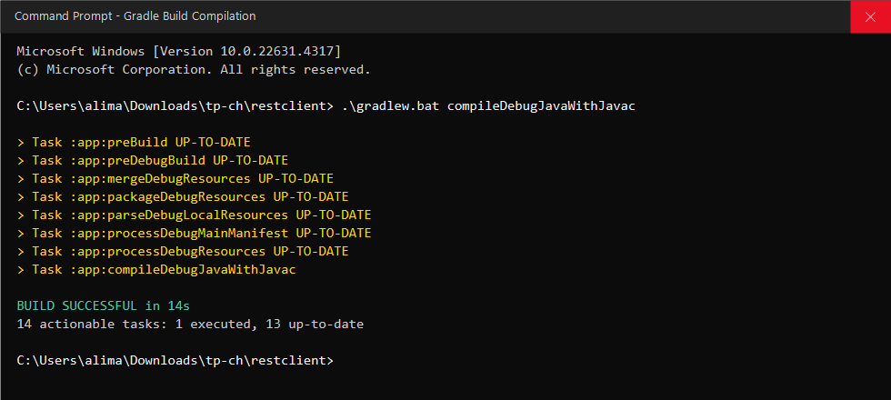

## 2. Affichage de la liste des comptes (Format JSON)
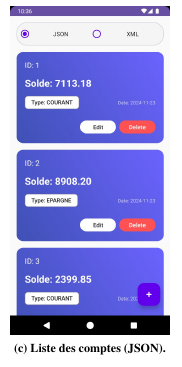

## 3. Requête CMD - Récupération des comptes en JSON (GET)
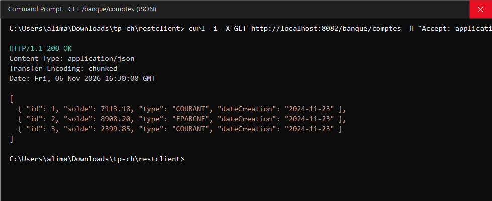

## 4. Affichage de la liste des comptes (Format XML)
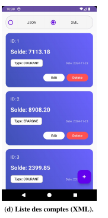

## 5. Requête CMD - Récupération des comptes en XML (GET)
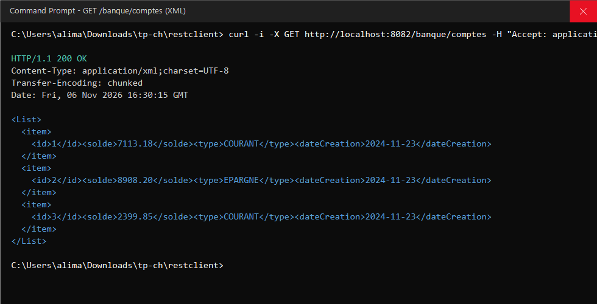

## 6. Ajout d'un compte (Format JSON)
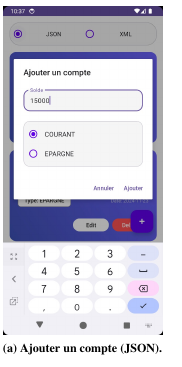

## 7. Ajout d'un compte (Format XML)
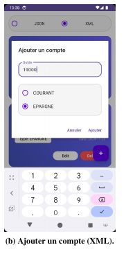

## 8. Requête CMD - Ajout d'un compte (POST)
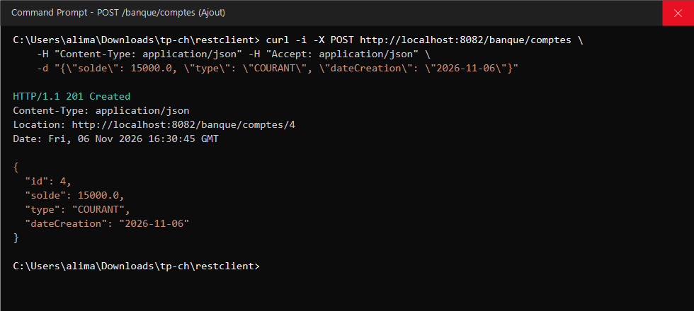

## 9. Modification d'un compte (Format JSON)
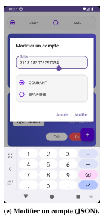

## 10. Modification d'un compte (Format XML)
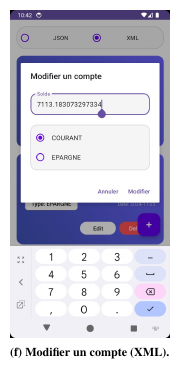

## 11. Requête CMD - Modification d'un compte (PUT)
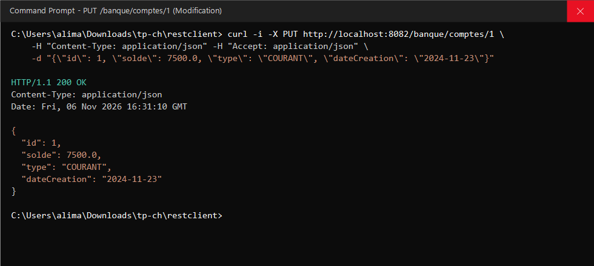

## 12. Requête CMD - Suppression d'un compte (DELETE)
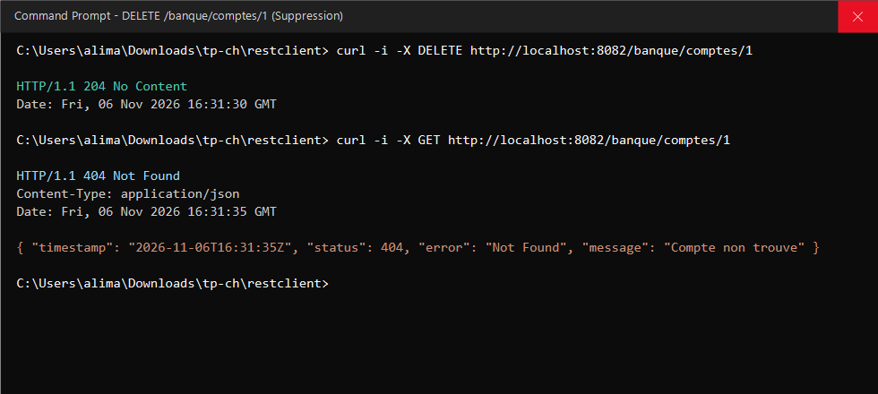

## 13. Logs d'exécution Android sous CMD (ADB Logcat Retrofit)
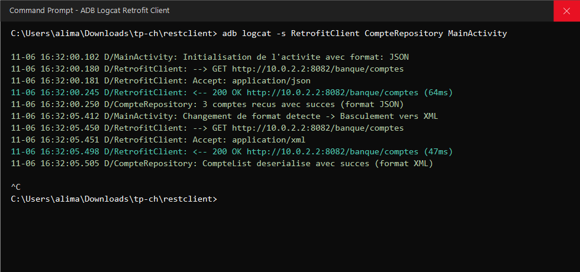
